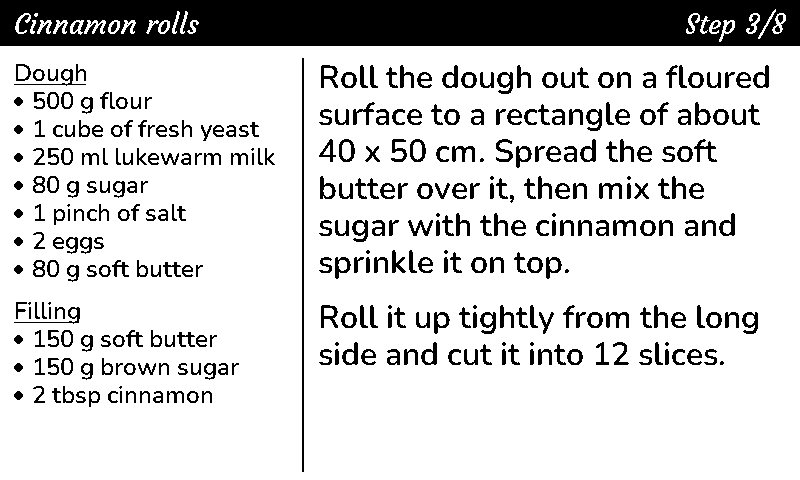

# Mealie recipe display for the LilyGo T5 7.5" e-paper

Shows the recipe you are cooking from [Mealie](https://mealie.io) on a 7.5" e-paper display: the current step on
the right, the ingredients next to it on the left. [Home Assistant](https://www.home-assistant.io) sits in the
middle, and the display runs [ESPHome](https://esphome.io).



*This picture comes from the drawing code of the firmware. It is not a photo.*

- Send a recipe to the display from Mealie with one click.
- Turn the pages with the three buttons on the board, or from Home Assistant.
- A page turn takes about 1.4 seconds and does not flash.
- The display empties itself one hour after the last change.
- Labels in English or German.

## How it works

```
Mealie --POST--> Home Assistant webhook --> sensor.epaper_recipe_screen --> display
                        ^                                                      |
                        +------------------ button events ---------------------+
```

1. A recipe action in Mealie posts the recipe to a webhook in Home Assistant.
2. The package in [homeassistant/](homeassistant/mealie_epaper.yaml) keeps the recipe and the current page, and
   puts what belongs on the display into `sensor.epaper_recipe_screen`.
3. The firmware in [esphome/](esphome/mealie-epaper.yaml) reads that sensor and draws it. A press on a button of
   the board goes back to Home Assistant as an event.

Home Assistant only holds data. It does not need the name or the address of the board, and all words on the
display come from the firmware.

## What you need

| Part | Notes |
|---|---|
| LilyGo T5 V2.4.1 with the 7.5" black/white e-paper (DKE DEPG0750BN, 800x480) | On USB power. WiFi stays on, so it is not built for battery. |
| ESPHome | 2026.9 or newer |
| Home Assistant | Tested with 2026.10 |
| Mealie | A version that has recipe actions |

So far this has run on one board.

## Setup

### 1. Flash the display

```sh
cd esphome
cp secrets.example.yaml secrets.yaml
```

Put the name and password of your WiFi and an API key into `secrets.yaml`. `openssl rand -base64 32` makes a key.
Then connect the board with USB and flash it:

```sh
esphome run mealie-epaper.yaml
```

### 2. Add the display to Home Assistant

Open **Settings > Devices & services**. The board shows up as discovered. If it does not, add the ESPHome
integration there with the IP address of the board. Enter the API key from `secrets.yaml` when Home Assistant asks
for it.

Without this step the display stays empty.

### 3. Install the package

Copy [homeassistant/mealie_epaper.yaml](homeassistant/mealie_epaper.yaml) to `<config>/packages/` and make sure
`configuration.yaml` has these lines:

```yaml
homeassistant:
  packages: !include_dir_named packages
```

Restart Home Assistant.

### 4. Connect Mealie

1. Start Mealie with the environment variable `HTTP_ALLOW_LIST` set to the address of Home Assistant. Without it
   Mealie does not send requests to addresses in your home network.
2. In Mealie, open **Data Management**, go to **Recipe Actions** and add an action of the type POST with this
   address:

   ```
   http://<home assistant>:8123/api/webhook/epaper_recipe
   ```

3. Open a recipe and run the action. The display shows the first step.

The webhook only takes requests from your home network. If Mealie reaches Home Assistant from outside, read the
note at `local_only` in the package.

## Using it

The three buttons on the board (IO37, IO38, IO39) do previous, next and clear. The same is in Home Assistant, for
a dashboard, a voice assistant or an automation:

| Entity | What it does |
|---|---|
| `script.epaper_recipe_next` | Go to the next step |
| `script.epaper_recipe_previous` | Go to the previous step |
| `script.epaper_recipe_show` | Show the current step again, or jump to the page you give it |
| `script.epaper_recipe_clear` | Empty the display |
| `sensor.epaper_recipe` | The recipe that was sent last |
| `sensor.epaper_recipe_screen` | What the display shows right now |
| `counter.epaper_recipe_page` | The number of the page that is showing |
| `timer.epaper_recipe_clear` | Runs while the display shows something |

The display empties itself when the timer ends, one hour after the last change. For another time, change
`duration` of the timer in the package. After that, next or previous brings the step back that was showing.

There are two kinds of refresh:

| Refresh | When | Time |
|---|---|---|
| Fast | Page turns | About 1.4 seconds, no flashing |
| Clean | A new recipe, emptying the display, the first picture after a start | 5 to 7 seconds, flashes |

The fast refresh leaves faint shadows of older pages. The clean one removes them.

## Your own settings

Leave `mealie-epaper.yaml` as it is. Copy [esphome/local.example.yaml](esphome/local.example.yaml) to
`esphome/local.yaml`, set your values there and flash `local.yaml` instead. Git ignores that file.

```yaml
substitutions:
  language: de

packages:
  recipe_display: !include mealie-epaper.yaml
```

| Setting | Default | What it is |
|---|---|---|
| `language` | `en` | Language of the words on the display, `en` or `de` |
| `font_text`, `font_text_weight` | `Nunito`, `600` | Font of the step and the ingredients, a name from [Google Fonts](https://fonts.google.com) |
| `font_title`, `font_title_weight` | `Courgette`, `400` | Font of the black bar at the top |
| `line_spacing` | `86` | Distance between lines, in percent of what the text font asks for |
| `rotation` | `0` | `0` or `180`, depending on which way up the display stands |
| `full_update_every` | `8` | After this many fast refreshes, one refresh moves every pixel |
| `name`, `friendly_name` | `mealie-epaper`, `Recipe display` | Name of the board in your network and in Home Assistant |
| `pin_...` | T5 V2.4.1 | The pins of the display and the buttons |

## Good to know

- Each step is one page. A step of more than 600 characters is split over several pages, like "3/8 (1/2)".
- The ingredients take the largest of three font sizes that fits. If even the smallest does not fit, the list ends
  with "+4 more".
- If you scaled the recipe in Mealie, the display says so. The amounts on the display are not scaled.
- The fonts have the letters of the European languages that use the Latin alphabet. Emoji are dropped, other
  unknown characters show as a question mark.
- Fractions from Mealie show as ½, ¼ and ¾, others as 1/3 or 5/16.

## Notes on the panel

For anyone who wants to use the DEPG0750BN with ESPHome, this is what happened on the way:

- `waveshare_epaper` with the model `7.50inV2p` resets the board. It sends the picture byte by byte, which takes
  longer than the watchdog of ESP-IDF allows.
- `epaper_spi` with the model `Waveshare-7.5in-V2` works. Its fast and partial refresh uses a waveform that
  Waveshare panels have built in. This panel does not have it, so every refresh takes about 4 seconds.
- The fast refresh here loads the short waveform from LilyGo's own driver through `init_sequence` before each
  refresh. Only the pixels that change are moved.
- The clean refresh is a second `epaper_spi` entry on the same pins, with the built-in waveform of the panel. The
  driver can not change the waveform while it runs, hence the second entry. After a clean refresh the fast entry
  draws the same picture once more, so that the panel knows what it shows.

## Credits

- The waveform values and the pins come from the 7.5" driver in
  [LilyGo's T5 e-paper examples](https://github.com/Xinyuan-LilyGO/LilyGo-T5-Epaper-Series), which is based on
  [GxEPD](https://github.com/ZinggJM/GxEPD) by Jean-Marc Zingg.
- The fonts are [Nunito](https://fonts.google.com/specimen/Nunito) and
  [Courgette](https://fonts.google.com/specimen/Courgette), both under the SIL Open Font License. ESPHome downloads
  them when it builds the firmware. They are not part of this repository.

## License

[MIT](LICENSE)
